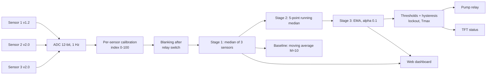

# Final DSP thought process and workflow (three-sensor version)

> **Superseded filter design (2026-10-30).** The paper's final DSP approach, which the firmware (v2.1) and the
> dashboard now run, is per sensor: raw ADC at 1 Hz, then a 3-point running median for isolated spikes, then a
> 5-point moving-average FIR low-pass. The output is the smoothed moisture signal, classified as DRY or WET only.
> It is evaluated as raw vs filtered, noise reduction and response delay. The cross-sensor median / running
> median 5 / EMA 0.1 chain below is the earlier design. `analysis/` still computes it, so do not copy its
> numbers into the report until those scripts are switched over.

The slides describe one sensor. The instructor wants three, so the DSP story changes in one place: **the first processing stage now uses the sensors against each other**, and the rest of the chain handles what the sensors share.

## The idea in one sentence

Three capacitive sensors in one tray each measure the same slow moisture `s[n]` plus their own offset, noise and glitches. Calibration removes the offsets, the **cross-sensor median** throws away whichever sensor is wrong *right now*, a **running median** removes glitches that hit all sensors at once, and an **EMA** averages out the remaining random noise, so threshold decisions follow the soil rather than the electronics.

## Signal model (what each stage is for)

`x_i[n] = s[n] + d_i + v_i[n] + p_i[n]`

| Term | Meaning | Removed by |
|---|---|---|
| `s[n]` | true tray moisture, changes over minutes to hours | kept |
| `d_i` | fixed offset of sensor *i* (v1.2 and v2.0 boards read differently) | per-sensor calibration (Eq. 2) |
| `v_i[n]` | random noise, different on every sensor | cross-sensor median, then EMA |
| `p_i[n]` | impulses: single-sensor faults, or common supply glitches when the pump switches | cross-sensor median (single-sensor), running median + blanking (common-mode) |

## Pipeline

## Why each choice (and what it costs)

| Stage | Does | Does not do | Cost |
|---|---|---|---|
| Cross-sensor median | Rejects one bad sensor at every sample; reduces random noise a little | Cannot reject a disturbance that hits all three sensors together (pump supply glitch) | None in time |
| 5-point running median | Removes 1 to 2-sample impulses completely, including common-mode ones | Does not smooth Gaussian noise | About 2 samples of delay |
| EMA, alpha 0.1 | Single-pole low-pass: white-noise std x0.229, time constant 9.5 s | Cannot remove slow drift (it is the signal) | 90% rise about 22 s on an ideal step |
| Moving average, M=10 (baseline) | Noise std x0.316, 90% rise 9 s | Spreads an impulse over M samples instead of removing it | 4.5 s average delay |
| Moving average, M=19 (extra baseline) | Same white-noise gain as the EMA, the fair comparison | Same impulse weakness | 9 s average delay |
| Blanking (3 s after a relay switch) | Holds the last valid readings while the pump disturbs the supply | | Ignores real changes for 3 s |

So the honest expectation, to test and not to assume: the proposed chain should win on **spikes and decision toggles**, be about equal to a long moving average on **standard deviation**, and lose on **response time**. The report should say whichever of these the data shows. This is the same "filter choice depends on the goal" conclusion as Mawarni et al. (2026).

## Measures (all computed by `analysis/analyze_log.py`)

Standard deviation and peak-to-peak (steady state), spike count, decision toggles at a fixed threshold, 90% response time (t90), spectrum before and after smoothing, spikes during pump switching with and without blanking.

## Workflow, start to finish

1. **Build and flash** (`firmware/soil_dsp`), place three probes in the tray.
2. **Test 1, calibrate** each sensor in air and water (dashboard buttons or `d`/`w`). Fixes `d_i`.
3. **Test 2, steady state**, 30 min or more, pump disabled. Gives noise, spikes, toggles, spectrum.
4. **Test 3, step**, add a measured volume of water at a noted time. Gives t90.
5. **Test 4, pump interference**, cycle the pump with the probes dry of new water, with and without blanking.
6. **Analyse** with the four commands in the README; copy the tables and figures into the report.
7. **Write results** from the printed numbers only (see `PAPER_PATCHES.md`).

## Slide text for the three-sensor version

**Problem statement (replace the bullets under the signal chain)**
- Soil moisture readings from a capacitive sensor fluctuate even when the soil changes little.
- Fluctuation, sensor-to-sensor offsets and pump-switching spikes make a threshold decision flip back and forth.
- Three sensors in one tray give redundant measurements of the same moisture.
- DSP combines them and smooths the result so the decision follows the soil.

**Signal chain strip (replace the single-sensor strip)**
Tray soil → 3 capacitive sensors → ADC samples at 1 Hz → calibrated index → cross-sensor median → running median → EMA → moisture decision (DRY / OK / WET)

**DSP focus strip**
ACQUIRE (3 sensors) → SAMPLE (1 Hz) → CALIBRATE → COMBINE (median of 3) → DESPIKE (running median) → SMOOTH (EMA) → COMPARE (vs raw and moving average) → INTERPRET (status + dashboard)

**Objectives 01 to 04 (keep the numbering, change the content)**
1. Signal acquisition: acquire three sensor signals at 1 Hz and represent each as a calibrated discrete-time signal.
2. Signal analysis: characterise the raw signal in time (mean, standard deviation, spikes) and frequency (magnitude spectrum).
3. DSP processing: implement cross-sensor median, running median and EMA in real time on the ESP32-S3.
4. Performance comparison: compare raw, moving-average and proposed signals on standard deviation, spikes, decision toggles and 90% response time; show them on a web dashboard.

The references slide stays valid; add Mawarni et al. (2026) for the filter comparison, Kulmány et al. (2022) and Cabia et al. (2025) for per-sensor calibration.
