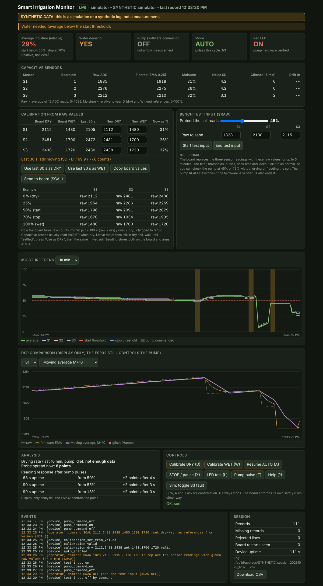

# Smart Irrigation Monitor (PC software)

The computer side of the system. It reads the ESP32-S3's USB serial telemetry
(`firmware/smart_irrigation/smart_irrigation.ino` v2.0, protocol v1; v1.0 firmware works too) and shows it live in a browser:
the three capacitive sensors (raw ADC, firmware-filtered ADC, relative %), the average, water demand,
pump command, LED, AUTO/MANUAL/LOCKOUT, pulse count, faults, plus logging and DSP analysis.



```
capacitive sensors -> ESP32-S3 (12x ADC average, EMA 0.25, calibration, pump safety logic)
                        |  USB serial, 115200, one JSON line per second + "#EVENT" lines
                        v
               irrigation_ui (this folder) -> http://127.0.0.1:8765/  + CSV log with PC timestamps
```

Pump control stays on the ESP32. The app only displays, logs and analyses data, and forwards the
single-letter commands you click. The firmware applies its own checks to each command, whatever the app sends.

## Run it

Python 3.9 or newer. Only one package is needed:

```bash
pip install -r software/requirements.txt
```

From the `software/` folder:

```bash
python -m irrigation_ui --port COM7
```

On Linux the port is usually `/dev/ttyACM0` (native USB) or `/dev/ttyUSB0` (USB-UART chip). Leave
`--port` out and the app picks the ESP32 automatically if exactly one is plugged in.
`python -m irrigation_ui --list-ports` shows what is connected.

**Close the Arduino Serial Monitor first.** Only one program can hold the COM port.

No board yet? Use the simulator. Everything it shows is labelled SYNTHETIC:

```bash
python -m irrigation_ui --sim --sim-verified
```

`--sim-verified` makes it behave as if `PUMP_HARDWARE_VERIFIED=true`, so AUTO watering can be seen.
Without it, it behaves like the firmware as shipped: the pump is blocked. `--sim-fresh` starts it
uncalibrated. The extra button "Sim: toggle S3 fault" exists only in the simulator.

To replay a capture (any file of serial output, for example the handoff's synthetic sample):

```bash
python -m irrigation_ui --replay ../data/synthetic/Smart_Irrigation_Synthetic_Telemetry.jsonl
```

Options: `--http-port`, `--log-dir` (default `logs/`), `--no-log`, `--start-pct/--stop-pct`
(the thresholds drawn on the chart; they must equal `START_WATERING_PCT`/`STOP_WATERING_PCT` in the
.ino, and the app warns if the board's behaviour contradicts them), `--speed`, `--loop`.

## What the dashboard shows

| Area | Content |
|---|---|
| Header / alerts | LIVE / NO DATA / DISCONNECTED, port, last record time. Alerts in order of severity: disconnected, no data, protocol mismatch, sensor fault, lockout, uncalibrated, pump hardware not verified, threshold mismatch, water needed, AUTO off, missing records. |
| Cards | Average %, water demand, pump **command**, mode, pulses x/3, LED, hardware-verified flag |
| Sensors | Board pin label, raw, filtered, %, sample-to-sample noise, glitches (Hampel, 5 min), raw drift per hour with the pump idle |
| Moisture trend | Average and S1-S3 % with the start/stop thresholds, pump-command periods shaded. 2/10/60 min |
| DSP comparison | One sensor's raw counts vs the firmware EMA vs a dashboard filter: moving average M=10, EMA 0.10, running median 5 + EMA 0.10 (the report's two-stage filter), EMA 0.25. Detected glitches are marked |
| Analysis | Drying rate (%/h, from samples at least 60 s after the last pulse), how long the reading takes to rise 2 points after each pulse, probe spread, warnings (probes disagree, stuck at 0/100 %, noisy, one probe drifting) |
| Calibration from raw values | The references the board uses, the median of the last 30 s of filtered readings per sensor (with a settled / still moving indicator), editable new DRY/WET values, the live % those values would give, and a raw-to-% table at 0/25/50/70/100%. **Send to board** stores them with `$CAL` |
| Bench test input | A slider for a target %, converted to raw counts per sensor with the board's references (or type the raw values). **Start test input** sends `$RAW` (5 min maximum), **End test input** sends `$RAW OFF`. Rows turn amber and the TFT says TEST INPUT while it runs |
| Controls | D, W, A, T, `$CAL` and `$RAW` need a confirmation dialog, and the server refuses them without it. X (stop and pause) and End test never need one. All disabled during replay |
| Events / Session | `#EVENT` lines from the board, app and operator actions, record counts, missing records, rejected lines, board restarts, CSV download |

## Logs

Every session writes `logs/session_YYYYmmdd_HHMMSS.csv` (one row per record) and a matching
`.events.log`. The simulator and synthetic replays write `SYNTHETIC_session_...` files, and those
CSV files start with a `# SYNTHETIC` line.

CSV columns: `pc_time` (ISO 8601 with time zone, when the PC received the line), `pc_epoch_s`, `source`,
`ms` (board uptime), `raw1..3`, `filt1..3`, `pct1..3`, `average_pct` (empty = null), the booleans as 0/1,
`pulses`, `missing_before` (records lost just before this one).

Missing records are detected from `ms`. A jump of more than 1.5 s counts as `round(jump/1000)-1`
missing records. If `ms` goes backwards, the board restarted. A reconnect does not count as a gap.

## Serial interface (protocol v1)

Taken unchanged from the handoff, section 7. The firmware is the authority.

* 115200 baud, USB serial. Lines end in CRLF.
* Telemetry: one JSON object per line, starting with `{`, `"type":"telemetry"`, once per second.
* Diagnostics: lines starting with `#EVENT `.
* Anything else (boot ROM text, half a line after plugging in) is ignored and counted as noise.

| Field | Type | Meaning |
|---|---|---|
| `v` | int | protocol version. The app accepts `1` only and shows a protocol alert otherwise |
| `ms` | int | board uptime in ms, **not** a date. The app adds the PC time |
| `raw` | 3 x int 0-4095 | average of 12 ADC reads per sensor |
| `filtered_raw` | 3 x int | EMA (alpha 0.25) of `raw` |
| `moisture_pct` | 3 x (int 0-100 or null) | relative to the D/W references. null when uncalibrated or on a fault |
| `average_pct` | int or null | integer mean of the three |
| `calibrated`, `sensor_fault`, `water_needed`, `pump_commanded`, `led_on`, `auto_mode`, `lockout`, `hardware_verified` | bool | as named. `pump_commanded` is the software command, not measured flow |
| `pulses` | int | pump pulses in the current watering cycle (max 3) |
| `paused` | bool | v2: AUTO deliberately paused (X, sensor fault, dry calibration); survives a restart |
| `test_input` | bool | v2: a `$RAW` test input replaces the sensor readings |
| `dry_ref`, `wet_ref` | 3 x (int or null) | v2: the stored raw references (null = not set) |

The v2 fields are optional for the parser, so logs from firmware v1.0 still load.

A line with a missing field, a wrong type, an out-of-range value or the wrong length is rejected and
counted. It never shows up as a reading.

Commands (single ASCII letter, no newline needed): `D` dry reference, `W` wet reference (arms AUTO),
`A` resume AUTO, `X` stop + pause + clear lockout + end test input, `L` LED test, `T` 1.5 s pump pulse,
`?` help and stored calibration.

Line commands (start with `$`, end with a newline; the app sends them for you):

| Command | Effect |
|---|---|
| `$CAL d1 d2 d3 w1 w2 w3` | store dry and wet raw references (each 11-4084, dry and wet at least 150 apart). Arms AUTO like `W` |
| `$RAW r1 r2 r3` | TEST INPUT: use these raw values instead of the sensors for up to 5 minutes |
| `$RAW OFF` | end the test input |

How a raw reading becomes a percentage (same on the board and in the app):
`pct = clamp(round(100 * (filtered - dry) / (wet - dry)), 0, 100)`. With the handoff's illustration,
dry 3200 and wet 2000: raw 3000 is 17%, 2600 is 50%, 2200 is 83%. Those endpoints are only an example.

## Limits

* The percentages are relative to your two calibration points. They are not volumetric water
  content or plant-available water, and the 50/70 thresholds are prototype values.
* There is no flow sensor and no tank-level sensor. "Pump ON" means the board commanded it.
* The dashboard binds to 127.0.0.1 because it can send pump commands. Use `--host 0.0.0.0` only on a network you trust.
* The DSP comparison and analysis panels are display-only. Changing the filter there changes nothing on the board.

## Tests

`make app-test` (from the repo root) compiles the **real** `smart_irrigation.ino` for the PC with stubbed
hardware (`tests/fw_host_run.cpp`) twice: as shipped (the relay must never turn on) and with
`PUMP_HARDWARE_VERIFIED=true` (automatic pulses, soak, lockout, reboot persistence, `$CAL`, `$RAW`). Both
serial outputs are then fed through this app (`tests/test_irrigation_ui.py`). See `docs/INTEGRATION.md`. The same
file tests the parser, the simulator's safety limits, the analysis and the HTTP API. `make app-ui` opens the
dashboard in Chromium against the simulator (needs node and playwright).
